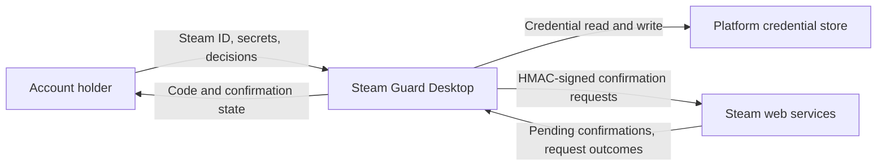
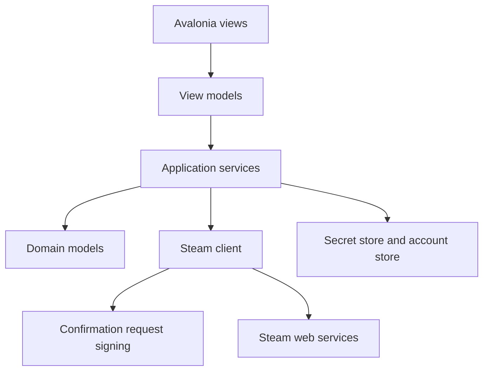
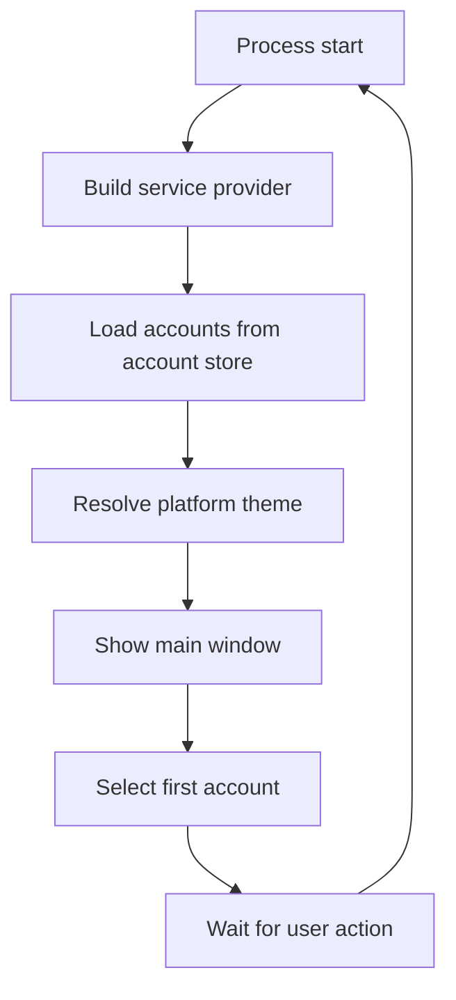
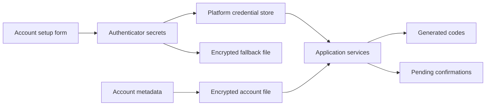
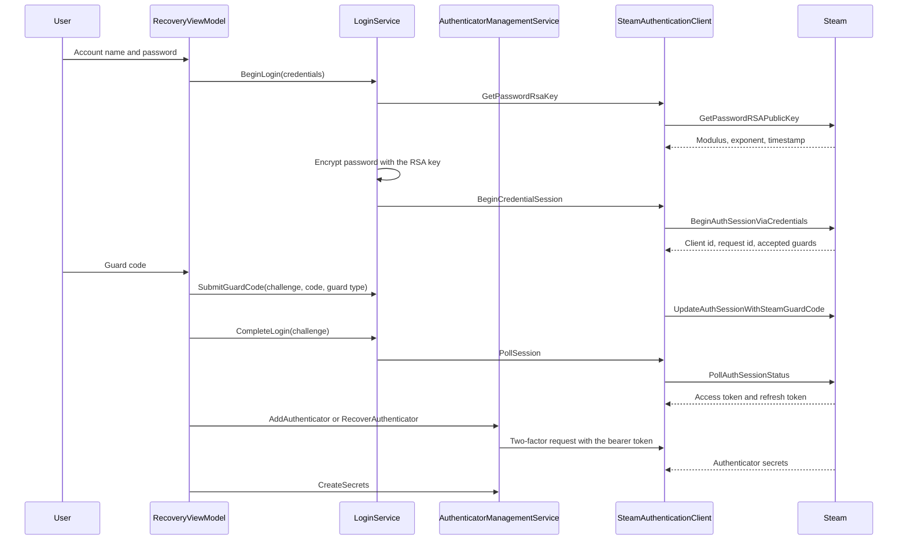
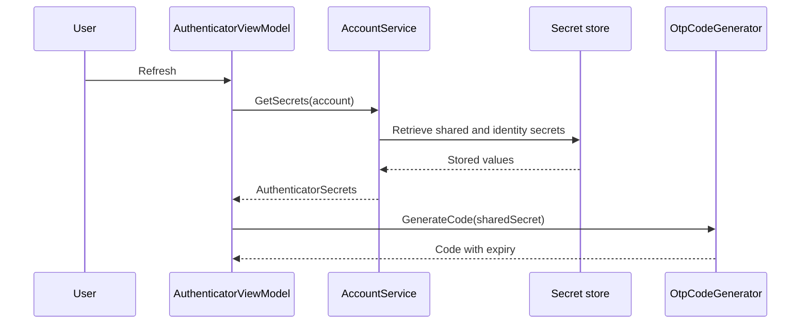
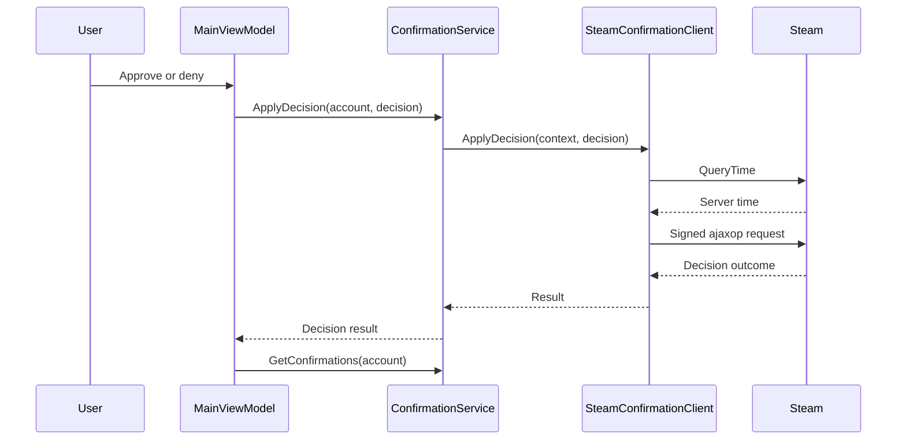
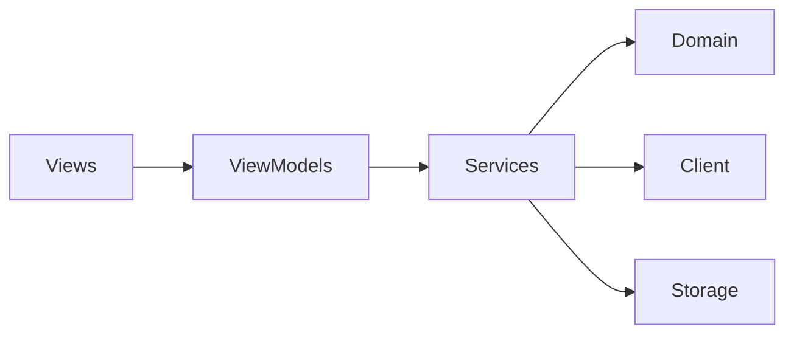

# Steam Guard Desktop Architecture

This document describes the current architecture of Steam Guard Desktop, a cross-platform desktop application that generates Steam Guard authentication codes and manages Steam mobile confirmations. It covers the implemented system only; the local reference material in `.temp/` is not part of the application.

## 📑 Table of Contents

- [Purpose](#purpose)
- [System Context](#system-context)
- [Architectural Style](#architectural-style)
- [Runtime Process](#runtime-process)
- [Components](#components)
- [Architectural Areas](#architectural-areas)
  - [Domain](#domain)
  - [Application Services](#application-services)
  - [Steam Client](#steam-client)
  - [Persistence](#persistence)
  - [Presentation](#presentation)
- [Data Architecture](#data-architecture)
- [Interfaces and Integrations](#interfaces-and-integrations)
- [Key Processes](#key-processes)
  - [Code Generation](#code-generation)
  - [Confirmation Decision](#confirmation-decision)
- [Cross-Cutting Concerns](#cross-cutting-concerns)
  - [Security and Privacy](#security-and-privacy)
  - [Error Handling](#error-handling)
  - [Observability](#observability)
  - [Configuration](#configuration)
  - [Concurrency and Resource Use](#concurrency-and-resource-use)
- [Dependency Direction and Rules](#dependency-direction-and-rules)
- [External Dependencies](#external-dependencies)
- [Deployment and Operations](#deployment-and-operations)
- [Compatibility Contracts](#compatibility-contracts)
- [Testing and Verification](#testing-and-verification)
- [Design Constraints](#design-constraints)
- [Extension Points](#extension-points)
  - [Platform Theme Resolution](#platform-theme-resolution)
  - [Secret Storage](#secret-storage)
- [Source Map](#source-map)
- [Related Documentation](#related-documentation)

## 🎯 Purpose

Steam Guard Desktop reproduces the Steam Guard features that an account holder needs on a desktop computer: generating the current two-factor code, listing pending confirmations, and approving or denying them. The document describes the ownership boundaries that allow the Steam protocol, the domain rules, and the user interface to change independently, and it is intended for contributors who need to locate responsibility before changing behaviour.

## 🌐 System Context

The application runs as a single user-owned desktop process. It reads account secrets from the platform credential store, derives authentication codes locally, and exchanges signed requests with Steam over HTTPS. No project-owned server participates in any flow.



The principal external boundaries are:
- **Platform credential store:** Owned by the operating system; the application only stores and retrieves named secret entries.
- **Steam web services:** Owned by Valve; the application reads server time, confirms mobile actions, and interprets the reported outcomes.
- **Local configuration files:** Owned by the application; encrypted account metadata is stored in the user application-data directory.

## 🏗️ Architectural Style

The codebase is a layered desktop client that follows the model-view-view-model pattern inside a single assembly. Domain models contain no transport or storage concerns, application services coordinate domain models behind interfaces, and the Steam client isolates HTTP and signing. Avalonia views bind to view models; view models call services only.



The principal architecture boundaries are:
- **Domain:** Holds account, authenticator, confirmation, and session models; depends on nothing else in the solution.
- **Application services:** Coordinate accounts, codes, confirmations, theming, and diagnostics; depend on domain models and abstractions.
- **Steam client:** Owns HTTP transport, request signing, response parsing, and protocol error translation.
- **Persistence:** Owns credential store access and encrypted metadata storage.
- **Presentation:** Owns Avalonia views, view models, and the composition root.

## 🔄 Runtime Process



The principal runtime sequence is:
1. `Program.Main` builds the Avalonia application builder and starts the classic desktop lifetime.
2. `App.OnFrameworkInitializationCompleted` builds the service provider, resolves the main view model, and loads configured accounts and the platform theme.
3. The main window displays the selected account, the current code, and any pending confirmations.
4. The service provider is disposed when the desktop lifetime exits.

## 🧩 Components

| Component | Responsibility | Principal Dependencies | Lifetime or Ownership |
|-----------|----------------|------------------------|-----------------------|
| `MainViewModel` | Coordinates account selection, code actions, and confirmation decisions | `IAccountService`, `IConfirmationService`, `IClipboardWriter`, `IThemeService` | Single instance per application |
| `AuthenticatorViewModel` | Presents the current code, countdown, and clock warning | `IOtpCodeGenerator`, `IClock` | Single instance per application |
| `AccountService` | Validates accounts and coordinates secret storage | `IAccountStore`, `ISecretStore`, `IDeviceIdentityProvider`, `IOtpCodeGenerator` | Singleton |
| `ConfirmationService` | Loads confirmations and applies decisions for an account | `ISteamConfirmationClient`, `IAccountService` | Singleton |
| `SteamConfirmationClient` | Performs signed HTTPS requests and interprets Steam responses | `HttpClient`, `ConfirmationRequestBuilder`, `ISteamResponseParser` | Singleton |
| `OtpCodeGenerator` | Produces Steam Guard codes and their validity window | `ISteamGuard`, `IClock` | Singleton |
| `ConfirmationRequestSigner` | Produces HMAC-SHA1 confirmation signatures | `System.Security.Cryptography` | Singleton |
| `PlatformThemeResolver` | Resolves the platform theme from a host description | None | Singleton |
| `ThemeService` | Applies the requested theme variant and reports the resolved theme and accent colour | `IPlatformThemeResolver`, `ISystemAccentColourProvider` | Singleton |
| `ClockDriftService` | Compares the local clock with the Steam server clock | `ISteamConfirmationClient`, `IClock` | Singleton |
| `LoginService` | Coordinates the sign-in exchange without persisting the password | `ISteamAuthenticationClient`, `IPasswordEncryptor` | Singleton |
| `AuthenticatorManagementService` | Enrols, inspects, removes, and recovers the authenticator | `ISteamAuthenticationClient`, `IDeviceIdentityProvider`, `IOtpCodeGenerator` | Singleton |
| `SteamAuthenticationClient` | Performs the sign-in and two-factor requests and interprets their responses | `HttpClient`, `ISteamRequestPayloadBuilder`, `ISteamResponseParser` | Singleton |
| `AvaloniaTicker` | Signals once per second so that the countdown can update | Avalonia dispatcher | Singleton |

## 🗂️ Architectural Areas

### Domain

Paths:
- `SteamGuardDesktop/Domain/Account`
- `SteamGuardDesktop/Domain/Authenticator`
- `SteamGuardDesktop/Domain/Confirmations`
- `SteamGuardDesktop/Domain/Steam`

Responsibilities:
- Represent non-secret account metadata and secret-bearing values.
- Represent generated codes, validity windows, clock drift, confirmations, and decisions.

Boundary rules:
- Must not depend on services, clients, storage, or view models.
- Must remain free of cryptography and transport concerns.

### Application Services

Paths:
- `SteamGuardDesktop/Service/Account`
- `SteamGuardDesktop/Service/Authenticator`
- `SteamGuardDesktop/Service/Confirmations`
- `SteamGuardDesktop/Service/Diagnostics`
- `SteamGuardDesktop/Service/Mapping`
- `SteamGuardDesktop/Service/Platform`
- `SteamGuardDesktop/Service/Theming`
- `SteamGuardDesktop/Service/Time`

Responsibilities:
- Coordinate validation, storage, code generation, confirmation decisions, and theme resolution.
- Expose result types that describe success, invalid input, and safe failure reasons.

Boundary rules:
- Must not depend on view models or Avalonia.
- Must reach the network only through the Steam client abstractions.

### Steam Client

Paths:
- `SteamGuardDesktop/Client/Steam`

Responsibilities:
- Build signed request parameters, send HTTPS requests, enforce timeouts and response size limits, and parse responses strictly.

Boundary rules:
- Must not mutate local account state.
- Must never log request addresses, signatures, or tokens.

### Persistence

Paths:
- `SteamGuardDesktop/DataAccess/Accounts`
- `SteamGuardDesktop/Service/Storage`

Responsibilities:
- Persist encrypted account metadata and store named secrets in the platform credential store.
- Fall back to an encrypted file only when the native store is unavailable.

Boundary rules:
- Must never persist a secret in plain text.
- Must report unavailability instead of silently discarding a secret.

### Presentation

Paths:
- `SteamGuardDesktop/ViewModels`
- `SteamGuardDesktop/Views`
- `SteamGuardDesktop/App.axaml`
- `SteamGuardDesktop/App.axaml.cs`
- `SteamGuardDesktop/ServiceConfiguration.cs`

Responsibilities:
- Compose the service graph, bind views to view models, and present status, code, and confirmation state.

Boundary rules:
- Views must not perform network or storage work.
- Feature views must consume shared resources instead of hard-coded colours or sizes.

## 💾 Data Architecture



| Data or Store | Owner | Representation and Storage | Lifecycle or Consistency |
|---------------|-------|----------------------------|--------------------------|
| `SteamAccount` | Account store | JSON serialised and encrypted with AES-256-GCM in the user application-data directory | Created on save, removed when the account is removed |
| Shared, identity, revocation, and access secrets | Credential store | Named entries in the native credential store; encrypted file fallback | Written on save, removed with the account |
| `SteamGuardCode` | `OtpCodeGenerator` | In memory only | Valid for the remainder of the current 30-second window |
| `Confirmation` | `SteamConfirmationClient` | In memory only, mapped from the Steam response | Replaced on every refresh and after each decision |

## 🔌 Interfaces and Integrations

| Interface or Integration | Direction | Contract | Owner | Failure Semantics |
|--------------------------|-----------|----------|-------|-------------------|
| `/ITwoFactorService/QueryTime/v0001` | Outbound | HTTPS GET returning the Steam server time as a Unix timestamp | Valve | A failure aborts the calling operation with a safe reason |
| `/mobileconf/getlist` | Outbound | HTTPS GET with signed parameters `p`, `a`, `k`, `t`, `m`, `tag` | Valve | `needauth` produces a re-authentication result; other failures produce a safe reason |
| `/mobileconf/ajaxop` | Outbound | HTTPS GET with signed parameters plus `op`, `cid`, and `ck` | Valve | `needsauth` produces a re-authentication result; other failures produce a safe reason |
| `/mobileconf/details/{id}` | Outbound | HTTPS GET with signed parameters using the `details` tag | Valve | A rejected request produces a safe reason; the HTML fragment is reduced to plain text |
| `/IAuthenticationService/*` | Outbound | HTTPS GET and POST carrying a protobuf-JSON `input_json` payload | Valve | Credential failures return the message reported by Steam; transport failures produce a safe reason |
| `/ITwoFactorService/*` | Outbound | HTTPS POST carrying a protobuf-JSON `input_json` payload, authorised with a bearer access token | Valve | Rejected authenticator operations produce a safe reason |
| `INativeSecretBackend` | Local | Credential read, write, and delete by entry name | Application and operating system | Unavailable stores are reported to the caller |
| `IPlatformThemeResolver` | Local | Pure function from host description to platform theme | Application | Unidentified environments resolve to the documented fallback |

## 🔀 Key Processes

### Sign-In and Authenticator Recovery



The password is encrypted with the RSA public key that Steam publishes, is used only for the exchange, and is cleared from the form as soon as the sign-in starts. The guard type is selected from the guards that Steam reports, so a code sent to the e-mail address and a code from an existing authenticator are both supported, while a challenge that only accepts an in-app approval reports that a code cannot be used. The access token that the sign-in issues is stored in the credential store, so confirmations keep working after the sign-in finishes. Recovery of a device that is no longer available is issued through the challenge endpoints rather than the revocation code, and the issued authenticator is stored with the same secret store that a manual account setup uses.

### Code Generation



The generator validates the Base32 alphabet before delegating to `SteamGuard.TOTP`, so an invalid secret produces no code instead of an exception. Expiry is the next 30-second boundary after the current moment, and the view model derives the countdown from the injected clock. `AvaloniaTicker` signals once per second so the countdown updates without a manual action, and an expired code is regenerated automatically. The clock comparison runs when the account list is loaded and surfaces a warning when the local clock differs from the Steam clock by more than 30 seconds.

### Confirmation Decision



The view model refuses a second decision while one is in progress, rejects unsupported confirmation types, and refreshes the list after a successful decision instead of mutating the list locally. Selecting a confirmation populates the creation time and, on request, loads the details fragment through `/mobileconf/details/{id}`, which is reduced to plain text before it is displayed.

## ⚙️ Platform Theming

The theme resolver is a pure function over a `PlatformDescription` value: Windows resolves to the Fluent theme, macOS to the Aqua theme, GNOME to Adwaita, KDE to Breeze, and any unidentified environment to the documented fallback. `ThemeService` applies the user preference as an Avalonia theme variant, so the system, light, and dark variants are selected at runtime with System as the default. The accent colour is read from the host through `ISystemAccentColourProvider`, which reads the Windows accent colour hint, the macOS accent colour default, the GNOME accent colour setting, and the KDE accent colour declaration. Feature views consume shared resources from `Views/ThemeResources.axaml` rather than platform-specific values.

## 🧵 Cross-Cutting Concerns

### Security and Privacy

Secrets are treated as credentials. They are erased from the setup form after a successful save, written only to the platform credential store or the encrypted fallback, and never logged. `SteamGuardInfoKey` declares sensitive structured keys so the logger masks secret, token, signature, and address values. Request addresses are sanitised before diagnostics are emitted. Approving or denying a confirmation requires an explicit user action. Account details, the displayed code, the confirmation list, and confirmation details are concealed when the window loses focus while `SteamGuardSettings.IsAccountHiddenWhenInactive` is enabled. Entered secrets are concealed unless `SteamGuardSettings.IsSecretRevealAllowed` is enabled and the user reveals them explicitly.

### Error Handling

Failures are translated into result objects with safe reasons at the boundary that owns them: storage returns `SecretStoreResult`, the Steam client returns `SteamClientResult<TValue>`, and services return their own result types. Expected remote rejections become failed results; transport failures become safe messages. View models surface the reason to the user and never throw to the framework.

### Observability

`SteamGuardLogger` writes structured lines through `NuciLog.Core` with an `Operation` on every call. Sensitive keys are declared as sensitive, and free-text messages are avoided for values that could identify an account. Account saves, account removals, authenticator codes, confirmation loads, confirmation decisions, secret store status, and theme resolution are recorded with operations and structured keys; secrets, tokens, signatures, and request addresses are never recorded. Logs are written to the console and, when enabled, to a log file.

### Configuration

| Configuration Area | Source | Responsibility | Supersede or Secret Policy |
|--------------------|--------|----------------|---------------------------|
| `SteamGuardSettings` | In-code defaults, created by the composition root | Base addresses, network timeout, response size limit, and privacy toggles | Contains no secrets |
| `DiagnosticsSettings` | In-code defaults, created by the composition root | Minimum level, line format, and log file path | Never contains secrets |
| Account metadata | Encrypted account file | Labels, identifiers, device identifiers, and secret entry names | Secret entry names only; values live in the credential store |

### Concurrency and Resource Use

The application is single-user and single-process. Services are registered as singletons, a single `HttpClient` instance is reused with an explicit timeout, and confirmation decisions are serialised by the in-progress guard in the view model. Response payloads larger than the configured limit are rejected.

## 🧭 Dependency Direction and Rules



The principal dependency rules are:
- Domain must not depend on services, clients, or view models.
- Services must not depend on view models.
- View models must not depend on the Steam protocol client.
- Production assemblies must not declare `InternalsVisibleTo`.

## 📦 External Dependencies

| Dependency | Responsibility | Integration Boundary | Architectural Consequence |
|------------|----------------|----------------------|---------------------------|
| `Avalonia` | Cross-platform desktop windowing and rendering | `App`, `Views` | The presentation layer is framework-bound; the rest of the solution is not |
| `CommunityToolkit.Mvvm` | Observable objects and property generation | `ViewModels` | View models use source-generated properties |
| `SteamGuard.TOTP` | Steam code computation | `OtpCodeGenerator` | Replaced through `IOtpCodeGenerator` for testing |
| `NuciWeb.HTTP` | HTTP client creation | `ServiceConfiguration` | Transport creation is isolated in the composition root |
| `NuciLog.Core` | Structured diagnostics | `SteamGuardLogger` | Structured keys and masking are provided by the package |
| `Microsoft.Extensions.DependencyInjection` | Service composition | `ServiceConfiguration` | Lifetimes are declared in one place |

## 🚀 Deployment and Operations

| Concern | Current Design | Architectural Consequence |
|---------|----------------|---------------------------|
| Process topology | One desktop process per user session | No server component or shared state |
| Deployment unit | Self-contained build published per platform | Each platform build is validated separately |
| Persistent state | Encrypted account file and credential store entries in the user profile | Removing the account removes both |
| Availability | Local code generation works offline | Confirmations require Steam connectivity |
| Recovery | A missing or unreadable secret produces an explicit unavailable state | The user re-enters the secrets |

## 🛡️ Compatibility Contracts

| Contract | Owner | Invariant | Verification | Change Policy |
|----------|-------|-----------|--------------|---------------|
| Confirmation signature | `ConfirmationRequestSigner` | Base64 of HMAC-SHA1 over the big-endian Unix timestamp followed by the tag | Unit test with a known fixture | Must remain byte-compatible |
| Confirmation query parameters | `ConfirmationRequestBuilder` | `p`, `a`, `k`, `t`, `m`, and `tag`, followed by `op`, `cid`, and `ck` | Integration test asserting the encoded request | Must follow the current Steam protocol |
| Confirmation type mapping | `SteamConfirmationType` | Numeric values reported by Steam map to domain values; unknown values are unsupported | Unit test | Unknown values must never be treated as decidable |
| Device identifier | `DeviceIdentityProvider` | Lowercase SHA-1 of `android:` followed by the Steam ID 64 | Unit test with fixed identifiers | Must remain stable for an account |
| Solution and project layout | Repository root | Four projects, main project first, tests alphabetised | Architecture test | Additions must preserve the naming convention |

## ✅ Testing and Verification

The solution separates unit, integration, and architecture tests. Unit tests verify code generation with known vectors, countdown boundaries, expiry detection, device identifiers, confirmation signatures, type mapping, theme resolution, accent colour reading, HTML-to-text conversion, secret redaction, password encryption, request payload construction, account validation, access-token persistence, and the sign-in and recovery view model. Integration tests use a scripted HTTP handler to verify signed query parameters, session cookies, confirmation details, sign-in exchanges, guard submission, token polling, authenticator status, removal, enrolment, lost-device recovery, error translation, re-authentication results, and encrypted store behaviour. Architecture tests enforce the layer dependency matrix, project and solution conventions, and source-file conventions.

Execute the principal automated verification with:

```bash
dotnet test SteamGuardDesktop.slnx
```

## ⚠️ Design Constraints

- **Encrypted session material:** The Steam access token is obtained by signing in or supplied during account setup. The password is used only for the RSA-encrypted exchange and is never persisted.
- **Protocol dependency:** Sign-in, confirmation, and authenticator behaviour depend on current Steam endpoints and response shapes; unknown confirmation types are deliberately not actionable.
- **Fallback storage:** When no native credential store is available, secrets are encrypted with a key derived from machine and user identifiers, which is weaker than a hardware-backed store.
- **Single assembly:** The layers are enforced by architecture tests rather than project boundaries.

## 🔧 Extension Points

### Platform Theme Resolution

1. Extend `IPlatformThemeResolver` or add a resolution rule in `PlatformThemeResolver`.
2. Register the rule through the existing singleton registration in `ServiceConfiguration`.
3. Add unit tests covering the new host description and confirm the fallback remains unchanged.

Resolution must stay free of display-server dependencies so that it remains testable.

### Secret Storage

1. Implement `INativeSecretBackend` for an additional credential store.
2. Return the new backend from `NativeSecretBackendFactory`.
3. Add integration tests for the read, write, and delete contract.

The backend must never return a secret through diagnostics and must report unavailability instead of silently failing.

## 🗺️ Source Map

| Area | Path |
|------|------|
| Composition root | `SteamGuardDesktop/ServiceConfiguration.cs` |
| Domain | `SteamGuardDesktop/Domain` |
| Application services | `SteamGuardDesktop/Service` |
| Steam client | `SteamGuardDesktop/Client/Steam` |
| Persistence | `SteamGuardDesktop/DataAccess` |
| Presentation | `SteamGuardDesktop/ViewModels`, `SteamGuardDesktop/Views` |
| Unit tests | `SteamGuardDesktop.UnitTests` |
| Integration tests | `SteamGuardDesktop.IntegrationTests` |
| Architecture tests | `SteamGuardDesktop.ArchitectureTests` |

## 📚 Related Documentation

- [README](./README.md) describes installation, usage, configuration, and development commands.
- [SECURITY](./SECURITY.md) describes supported versions, reporting, and scope.
- [PRIVACY](./PRIVACY.md) describes the data the application handles and where it is stored.
- [ROADMAP](./ROADMAP.md) describes current focus and planned labour.
- [CONTRIBUTING](./CONTRIBUTING.md) describes the contribution process and standards.